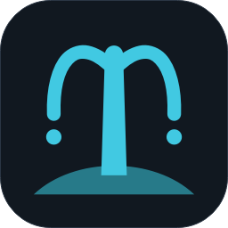
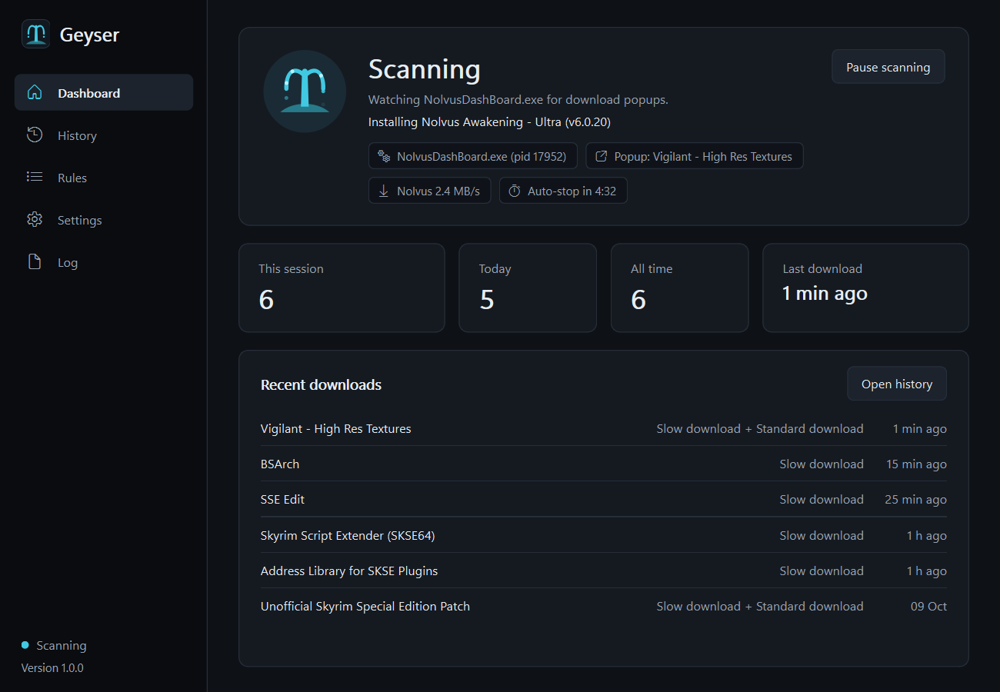
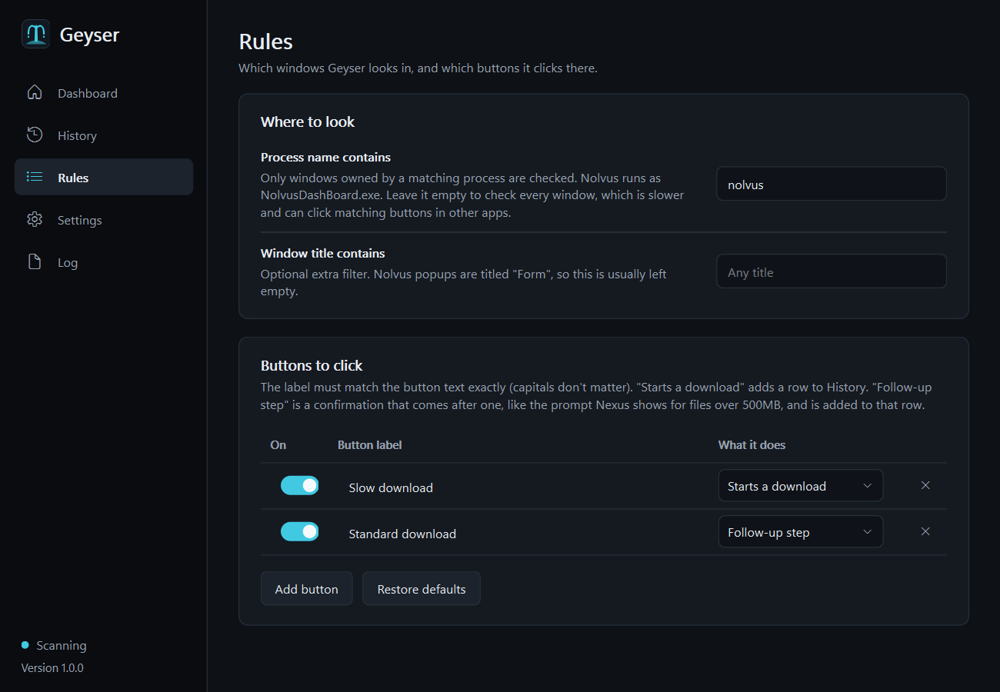

<p align="center"></p>

# Geyser

Geyser clicks **Slow download** on the manual download popups of Nolvus and Yugen, so you can install a modlist with a free Nexus Mods account without sitting there clicking every one.



*Dashboard, shown with sample data.*

## What it does

- **Clicks the popups for you.** When the installer opens a "Manual download" popup, Geyser presses **Slow download**. For files over 500MB, Nexus asks one more question, and Geyser answers **Standard download**.
- **Stays out of your way.** Clicks go through Windows UI Automation (the accessibility API), so your mouse never moves. While Geyser clicks, the popup isn't allowed to take focus, so a game or browser you're using stays in front. You can still click into the installer yourself whenever you like.
- **Runs itself.** Geyser starts scanning when an installer opens and waits when it's closed. If nothing happens for 5 minutes (you can change this) it goes idle. While the installer is downloading, the timer doesn't run, and Geyser wakes up again when it starts the next download.
- **Keeps a history.** Every download is logged with the mod name and time, searchable and exportable to CSV.
- **Lives in the tray.** It has a tray icon, a global pause/resume hotkey (Ctrl+Alt+G by default), optional Windows notifications and an option to start with Windows.

It doesn't bypass anything. Downloads still go through Nexus at free-account speed, with Nexus's usual delay. Geyser just presses the button you would have pressed.

## Requirements

- Windows 10 or 11
- [Nolvus Dashboard](https://www.nolvus.net/) or the Yugen installer

Geyser isn't affiliated with Nolvus or Nexus Mods.

## Install

Build `Geyser.exe` yourself (needs Python 3.12 on your PATH):

```bat
git clone https://github.com/IAmLaegion/Geyser.git
cd Geyser
build.bat
```

The exe ends up in `dist\Geyser.exe`. It's a single file, so you can move it anywhere.

Or run from source:

```bat
python -m venv venv
venv\Scripts\pip install -r requirements.txt
venv\Scripts\python run.py
```

The first launch of the exe can take around 15 seconds while Windows Defender scans the files it unpacks. After that it starts in about 3 seconds.

## Using it

Start Geyser, then start your Nolvus or Yugen install. The dashboard shows what Geyser is doing and why:

| State | Meaning |
|---|---|
| Scanning | An installer is running and Geyser is watching for popups. |
| Waiting for an installer | Neither installer is running. Geyser starts scanning as soon as one is. |
| Idle | Nothing happened for the auto-stop time. Geyser picks up again when the installer downloads or restarts, or when you press Resume. |
| Paused | You paused it. Popups are left alone until you resume. |

Closing the window keeps Geyser running in the tray. Right-click the tray icon to quit.

### Rules



The Rules page sets where Geyser looks (by default, windows owned by a process with "nolvus" or "yugen" in its name; separate names with commas) and which buttons it clicks. Button labels must match exactly, though capitals don't matter. A button marked **Starts a download** adds a row to History. One marked **Follow-up step** is a confirmation that comes after a download, like the large-file prompt, and is added to that row.

If Nexus renames a button, you can add the new label here without waiting for an update.

## How it works

Nolvus shows each popup as a WinForms window with an embedded Chromium browser (CefSharp). Yugen (`Yugen.Installer.exe`) copies that design with WebView2, using the same label and status bar text, so Geyser handles both the same way. That browser exposes the Nexus page's buttons to Windows UI Automation, so Geyser can find **Slow download** by its name and invoke it directly, the way a screen reader would. It doesn't look at pixels, so screen size, scaling and window position don't matter, and the popup can sit behind other windows.

To stop the click from pulling the popup to the front, Geyser briefly marks the popup window `WS_EX_NOACTIVATE` while it clicks, then removes the mark again.

The mod name comes from the popup's "Manual download [mod name]" label, and the download speed comes from the installer's own status bar.

## Your data

Everything stays on your PC, in `%APPDATA%\Geyser`:

- `settings.json`: your settings
- `history.db`: download history (SQLite)
- `geyser.log`: what the scanner did, for troubleshooting

Geyser makes no network connections.

## Development

```bat
venv\Scripts\pip install -r requirements-build.txt
venv\Scripts\python tools\preview.py out            &:: render every page to PNGs, offscreen
venv\Scripts\python tools\smoke_engine.py           &:: UI Automation lookups and the scanner's states
venv\Scripts\python tools\clickthrough.py           &:: drive every control and check its effect
```

None of the tools touch your real settings or history. They use a throwaway data folder.

## License

[MIT](LICENSE)
